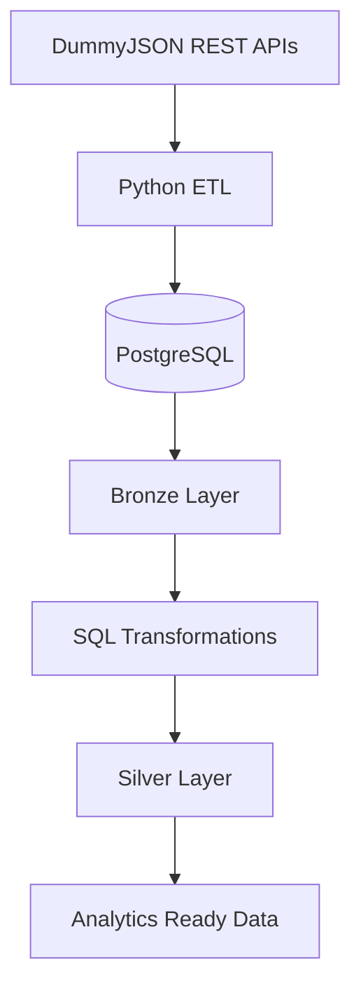

## PROJECT: E-COMMERCE SALES ANALYTICS PIPELINE ## 

A personal Data Engineering project that extracts e-commerce data from REST APIs, stores raw data in PostgreSQL, and transforms it into structured tables using a Medallion Architecture.

## Project Overview ##

The E-commerce Sales Analytics Pipeline is an ETL pipeline built to demonstrate the fundamentals of data ingestion, data transformation, and database design.

The project uses DummyJSON APIs as a data source and PostgreSQL as the target database. Raw API responses are stored in the Bronze layer, while cleaned and structured data is loaded into the Silver layer for further analysis.

## Objectives ##

Build an end-to-end ETL pipeline using Python and SQL.

Extract data from REST APIs and handle JSON responses.

Implement Medallion Architecture with Bronze and Silver layers.

Transform semi-structured JSON data into relational tables.

Practice database design, SQL transformations, and data integrity.

## Architecture



## Tech Stack

- **Language:** Python, SQL
- **Data Source:** DummyJSON REST APIs
- **Database:** PostgreSQL
- **Libraries:** SQLAlchemy
- **Architecture:** Medallion Architecture
- **Tools:** Git, GitHub

## Pipeline Workflow

| Stage | Description |
|---|---|
| Extract | Fetch product and cart data from REST APIs |
| Bronze | Store raw API responses as JSONB in PostgreSQL |
| Transform | Extract, clean, cast, and normalize JSON data using SQL |
| Silver | Store structured data in relational tables |

## Database Design

**Bronze Layer**
- `bronze.raw_products`
- `bronze.raw_carts`
- `bronze.raw_users`

**Silver Layer**
- `silver.products`
- `silver.users`
- `silver.carts`
- `silver.cart_items`

The Silver layer organizes raw data into structured relational tables to support downstream queries and analytics.

## Project Structure

```text
ecommerce-sales-analytics/
├── data/
├── etl/
├── sql/
├── .env.example
├── .gitignore
├── uv.lock
└── README.md
```

## Key Learnings

- REST API integration and JSON data handling
- ETL pipeline development with Python and SQLAlchemy
- Medallion Architecture implementation
- SQL-based data cleaning and transformation
- Relational database design and data integrity

## Future Improvements

- Incremental data loading and CDC
- Automated data quality checks
- Pipeline logging and error handling
- Workflow orchestration with Apache Airflow
- Gold layer for analytical reporting

---

**Project Type:** Personal Project  
**Focus:** Data Engineering | ETL | SQL | PostgreSQL | Data Warehousing

